# Tutorial: building a scenario presentation

*Leia em português: [scenario-tutorial.pt-BR.md](scenario-tutorial.pt-BR.md).*

This tutorial builds, step by step, the graphic presentation of the
`Recepção` (reception) scenario of a clinical case about syphilis in prenatal
care. When it's done, the Player shows each scene of this scenario on top of
the reception image, with a speech box at the bottom and the choices below it:

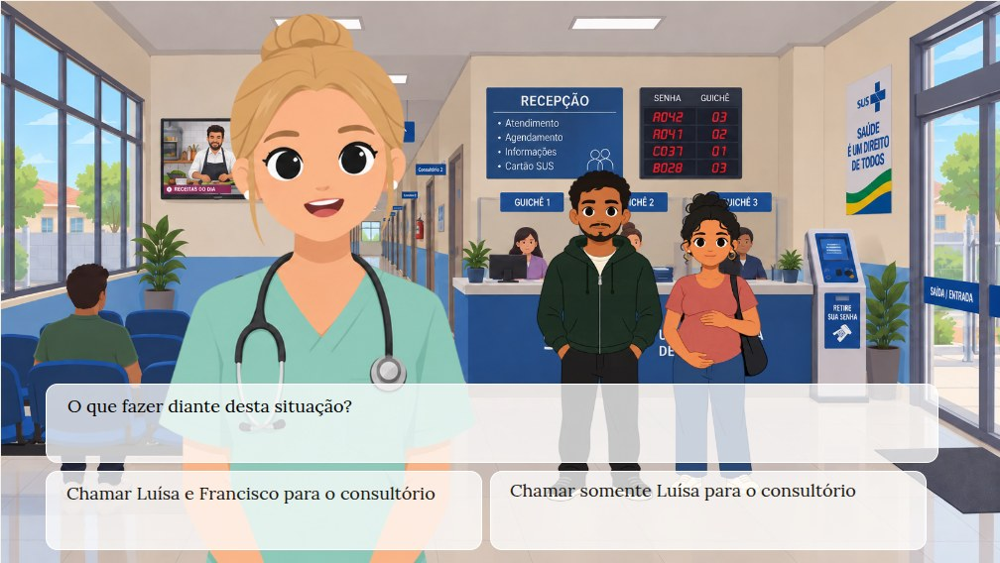

Everything here happens in **Presentation → Scenarios**. For the full
reference of what the IDs and containers do in play, see
[Graphic play](../README.md#graphic-play) in the README.

## Before you start

The narrative must already have scenes in the `Recepção` scenario (a heading
such as `# Abertura: Recepção (Start)`), and the presentation needs images:

1. **Presentation → Image Libraries:** add the library with the case images
   (here, `https://mundorum.github.io/harena-cases/ethics/syphilis/images/`).
2. **Presentation → Entity:** associate the narrative's entities with their
   images. The two interface pieces used below aren't in the narrative, so
   declare them with *Add entity* and give each its image:
   `@Caixa_de_Diálogo` (a dialog box) and `@Caixa_de_Opção` (an option box).

Then open **Presentation → Scenarios** and click `Recepção` to open its
design. The **Wide editor** button (top right) hides the rest of the app and
gives the canvas the whole window; all the pictures below were taken in it.

## 1. Insert a background image

Press **Choose background** and pick the `Recepção` image from the picker.

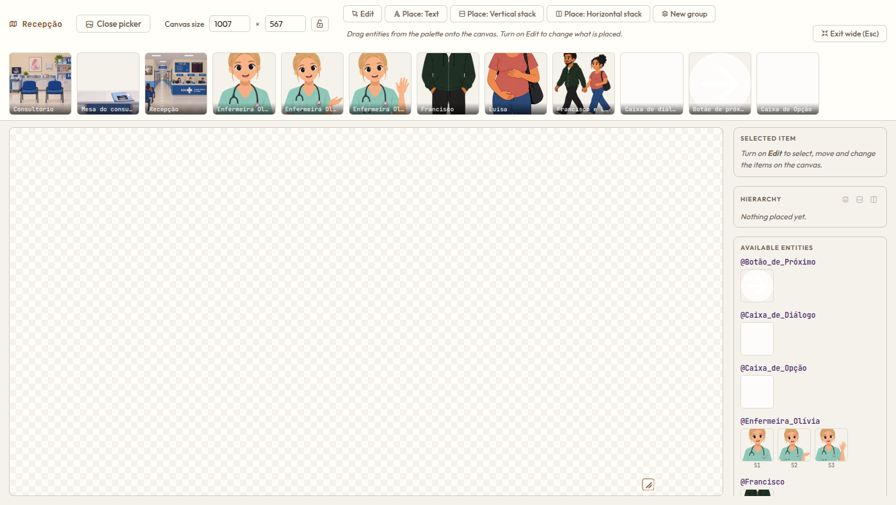

The canvas takes the image's own size (here 1672 × 941 px). Set the size the
scenario will be played at in **Canvas size**: turn on the lock beside it to
keep the proportion and type `1007` as the width; the height follows (`567`).
You can also drag the canvas's bottom-right corner, holding Shift to keep the
proportion. The background always fills the canvas.

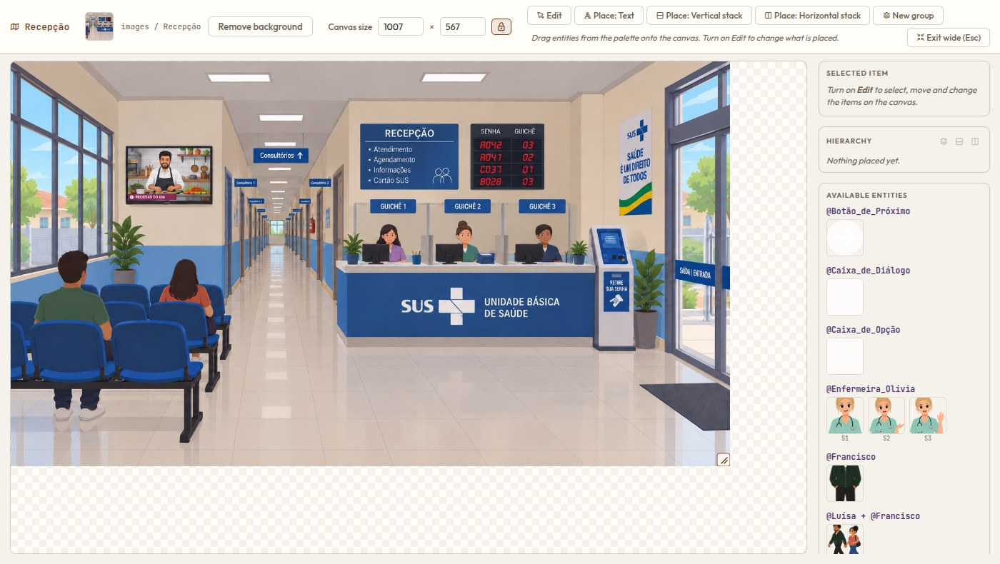

## 2. Insert an entity and a text

**An entity.** Drag the `@Caixa_de_Diálogo` tile from *Available entities*
(in the sidebar, below the hierarchy) onto the canvas. It arrives as an
80 × 80 image whose ID is the entity's name, `caixa_de_dialogo`.

Turn on **Edit**: in this mode a click selects an item and the sidebar shows
its properties. Move and resize the box by dragging it and its bottom-right
handle, or type the values in the inspector. In the example the box is
`900 × 80` at `45, 386`.

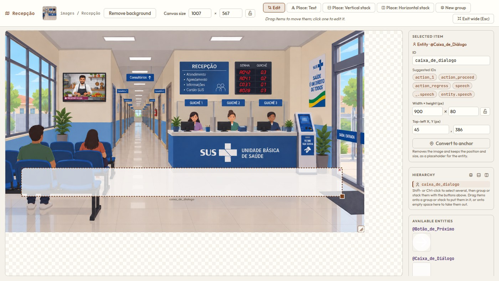

**A text.** Turn on **Place: Text** and drag a rectangle over the box. The new
text area gets the ID `text_1`, and the editor goes back to Edit with it
selected. In the inspector, set its font, size and color; *Initial text* is
only for the design and is replaced when playing. In the example the text
area is `860 × 60` at `67, 397`, in Lora 18 px, black.

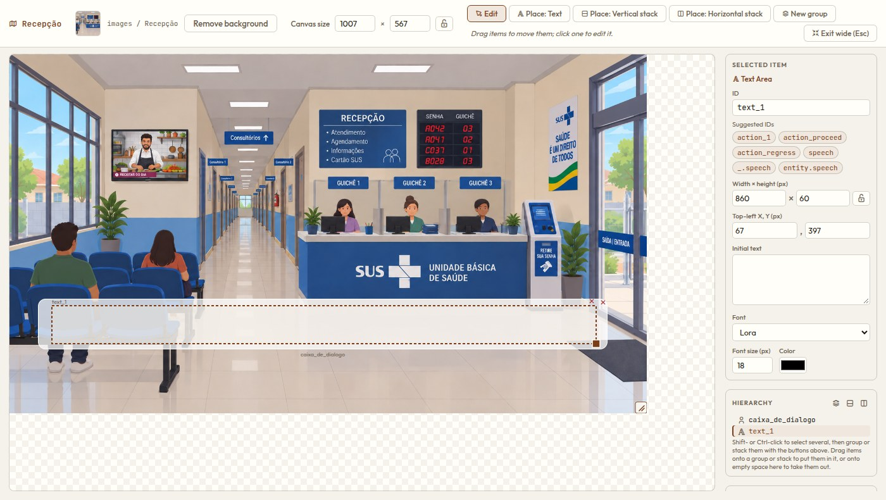

So far both are plain items: the Player wouldn't do anything with them yet.
What gives them a role is their ID.

## 3. The categories of IDs

In play, gnō looks for items with certain IDs and fills them in. When an item
is selected, the inspector suggests these IDs as chips under *Suggested IDs*;
a click on a chip renames the item.

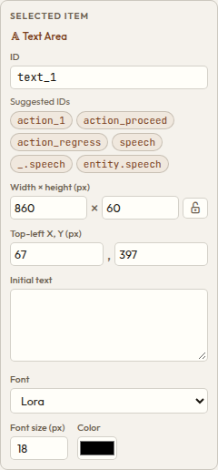

| ID | Role of the text area | Where its text comes from |
|---|---|---|
| `speech` | The general speech area. | Everything said in the beat: narration (unless `_.speech` exists) and dialogs (of entities that don't have their own area). |
| `_.speech` | The narrator's area. | The free text of the scene, written outside any dialog. |
| `entity.speech` | One entity's own area, such as `Luísa.speech` (with the entity's ID in place of `entity`). | The dialogs of that entity: `-- @Luísa: …`. |
| `action_N` | Choice number N: `action_1`, `action_2`, … | The label of the Nth divert of the scene (`* Label -> Target`). Clicking it goes to that divert's target. |

A few rules make these work together:

- **Pairs.** A text area and an entity can have the *same* ID. They then play
  the role together: the text area shows the text and the entity is its
  picture (the speech bubble, the button). In the exported SVG the text
  area's ID gets the suffix `_text` (`speech` and `speech_text`); in the
  editor you only see the ID you typed.
- **Showing and hiding.** A speech area with nothing to show at the current
  pause is hidden, and so is a choice that isn't on offer. The entity paired
  with it hides along.
- **Who is speaking.** When dialogs of different entities share the
  `speech` area, each one is prefixed with the speaker's name.
- **Fallbacks.** If the design has no area for a text, it isn't shown. If it
  lacks an `action_N` for a choice, the Player shows its regular button for
  it below the scenario, so a scene never gets stuck.

The suggestions also include `action_proceed` (continue past a pause) and
`action_regress` (go back one beat), the controls for moving through the
scene.

In this tutorial, `Recepção` gets one `speech` area, used by both narration
and dialogs, and two choices, `action_1` and `action_2`.

## 4. The `speech` pair, grouped

Select the dialog box entity and click the `speech` chip (or type `speech` in
*ID*). Do the same with the text area. They are now a pair.

Next, put them into a *group*, so they move as one and the box only shows
while there is speech. In the **Hierarchy** panel, click one of the two
`speech` rows and Shift- or Ctrl-click the other, so both are selected:

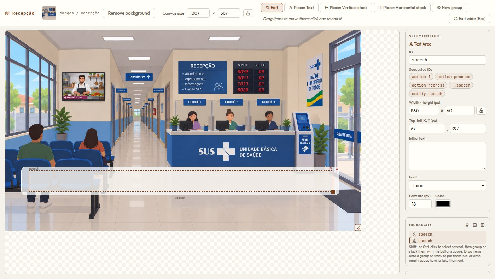

Press the first button at the top of the hierarchy, **Group the selected
items**. The new group is called `group_1`; rename it `group_speech`.

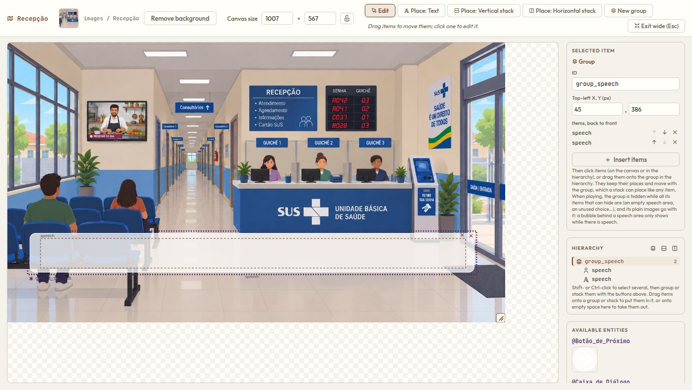

A group has no area of its own: it is just its items, drawn back to front in
the order shown under *Items, back to front* (the image first, so the text
stays on top).

Another way to build a group: press **New group** in the toolbar, then click
the items to put in it, on the canvas or in the hierarchy, and press **Done
inserting**.

## 5. The `action_1` pair, grouped

The first choice is built the same way, with the option box:

1. Drag `@Caixa_de_Opção` onto the canvas and size it: `440 × 80` at
   `45, 474`.
2. With **Place: Text**, draw a text area over it: `400 × 60` at `66, 485`.
3. Give both the ID `action_1`.
4. Select both in the hierarchy, group them and rename the group
   `group_action_1`.

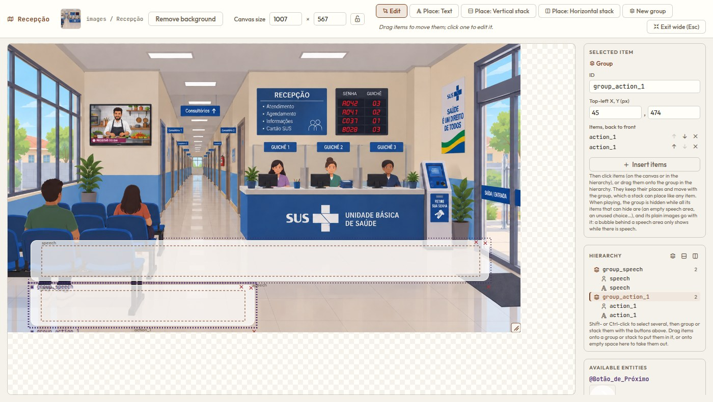

## 6. The `action_2` pair, grouped

Repeat for the second choice, to the right of the first:

1. Option box: `440 × 80` at `493, 474`.
2. Text area: `400 × 65` at `513, 482`.
3. ID `action_2` for both.
4. Group them as `group_action_2`.

The hierarchy now has three groups, each holding its pair.

## 7. A horizontal stack: `layout_actions`

A *stack* places its items the way a CSS flexbox does: a horizontal stack
lines them up left to right, each keeping its own size. It also skips hidden
items, so a scene with a single choice doesn't leave a hole where the second
one would be.

1. Turn on **Place: Horizontal stack** and drag a rectangle around the two
   action groups. The stack is called `layout_1`; rename it
   `layout_actions`.
2. In its inspector press **Insert items** and click `group_action_1`, then
   `group_action_2` (clicking their rows in the hierarchy is the easiest
   way). The order of clicks is the order in the stack. Press **Done
   inserting**.
3. Set *Along* to `Left`, *Across* to `Top` and *Gap* to `8`.

The shortcut: select both groups in the hierarchy and press the third
button at its top, **Put the selected items in a new horizontal stack**.

## 8. A vertical stack, aligned to the bottom

The last container stacks the speech above the choices:

1. Turn on **Place: Vertical stack** and drag a rectangle over the bottom
   of the scenario, covering the speech box and the choices. Rename the stack
   `layout_speech_actions`. (In the example it is `913 × 180` at `45, 381`.)
2. **Insert items:** first `group_speech` (on top), then `layout_actions`
   (below). Stacks can hold other stacks.
3. Set *Along* to **`Bottom`**, *Across* to `Left` and *Gap* to `8`.

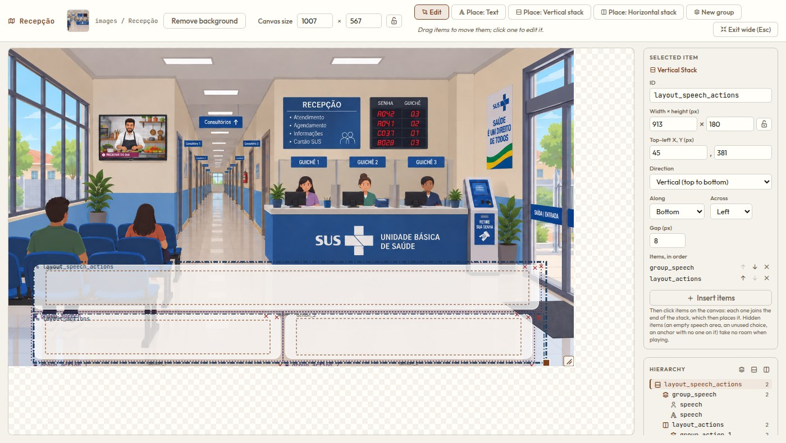

*Along = Bottom* is what makes the design adapt to the scene. The stack lines
up its visible items against its bottom edge:

- While the scene is only telling (no choices on offer), `layout_actions`
  is hidden and takes no room, so the speech box sits at the very bottom of
  the scenario.
- When the choices appear, they take the bottom and push the speech box up,
  above them.

## The result

Choose **Player** and play the narrative. In the first beat of the opening
scene there are no choices yet, so the speech is at the bottom:

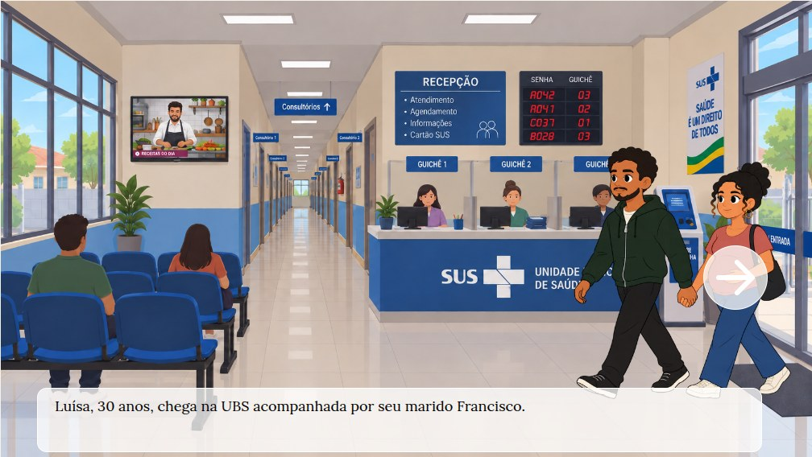

At the end of the scene the choices are offered: the two option boxes take
the bottom and the speech box moves up:

The opening scene has three diverts, but the design has only `action_1` and
`action_2`; the third choice appears as the Player's regular button below
the scenario. Add an `action_3` pair to `layout_actions` to bring it into the
scenario too.

To keep the work, use **Save** (browser storage) or **Download**, which
exports a zip where the design is `scene/recepcao.svg`.

## Going further

The real `Recepção` design also has:

- **Anchors** (`direita`, `esquerda`, `entrando`, `frente`): the places where
  the characters stand. Drag a character's image onto the canvas, size it,
  and press **Convert to anchor** in the inspector; the narrative then places
  entities with the anchor's name, as in `@Luísa direita feliz`.
- An **`action_proceed`** entity (`@Botão_de_Próximo`), the arrow button
  shown while the scene is paused, to continue.

How each of these behaves in play is described in
[Graphic play](../README.md#graphic-play).
